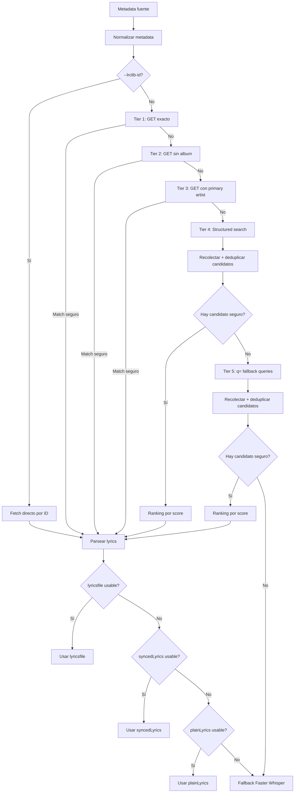

# Plan de implementación — LRCLIB Resilient Discovery, Matching & Fallback

## 1. Objetivo

Corregir el flujo de obtención de letras desde LRCLIB para evitar falsos negativos que actualmente provocan un fallback innecesario a Faster Whisper, sin introducir falsos positivos que puedan seleccionar letras de otra canción o de otra versión de la misma canción.

Caso de referencia:

```bash
uv run karaoke "https://www.youtube.com/watch?v=-48t4C0W90w" --language en
```

Metadata detectada:

```text
track:    Break the Fall (Acoustic)
artist:   Swsh, Olivia Quillin
album:    Break the Fall
duration: 296
```

LRCLIB contiene letras válidas para la canción, por ejemplo registros como:

```text
11695097
33960717
```

pero el lookup actual puede fallar debido a diferencias entre la metadata de YouTube y la metadata almacenada en LRCLIB.

La estrategia será:

> **ampliar progresivamente el discovery, pero mantener estricta la validación del candidato.**

LRCLIB debe ser preferido siempre que exista una coincidencia suficientemente segura. Faster Whisper seguirá siendo el fallback final.

---

# 2. Alcance

## Archivos a modificar

```text
colab/karaoke_job.py
tests/test_karaoke_job.py
```

Opcional:

```text
README.md
```

solo si se desea documentar brevemente el nuevo comportamiento multi-artista / multi-variante.

No se requiere deploy adicional. El CLI ya sube `colab/karaoke_job.py` al entorno Colab en cada ejecución.

---

# 3. Principios de diseño

La implementación debe seguir estas reglas:

1. No cambiar el comportamiento de `--lrclib-id`.
2. No usar Whisper mientras exista un candidato LRCLIB seguro.
3. No aceptar automáticamente el primer resultado de una búsqueda relajada.
4. Separar claramente:
   - **discovery:** encontrar posibles candidatos;
   - **validation:** decidir si un candidato puede utilizarse;
   - **ranking:** ordenar candidatos ya considerados válidos.
5. Empezar con metadata estricta e ir relajándola progresivamente.
6. Mantener la versión de la canción como señal relevante:
   - Acoustic
   - Live
   - Remix
   - Instrumental
   - Acapella
   - Radio Edit
   - etc.
7. Deduplicar candidatos por `id`.
8. Evitar una explosión combinatoria de requests.
9. Mantener los requests secuenciales.
10. Si LRCLIB no produce un match seguro, mantener el fallback actual a Faster Whisper.

---

# 4. Arquitectura propuesta



---

# 5. Tarea 1 — Normalización de metadata

Agregar helpers pequeños y testeables.

## 5.1 `_normalize_text`

Objetivo:

- lowercase;
- trim;
- colapsar espacios;
- normalizar puntuación para comparación;
- conservar el string original fuera del helper cuando sea necesario.

Ejemplo conceptual:

```python
_normalize_text(" Break  the Fall! ")
# -> "break the fall"
```

No debe eliminar información de versión de manera irreversible.

---

## 5.2 `_artist_variants`

Firma propuesta:

```python
def _artist_variants(artist: str | None) -> list[str]:
    ...
```

Objetivo:

Generar variantes útiles para **discovery**, no declarar que todas son artistas equivalentes.

Ejemplo principal:

```python
_artist_variants("Swsh, Olivia Quillin")
# [
#   "Swsh, Olivia Quillin",
#   "Swsh",
# ]
```

No conviene convertir automáticamente esto en:

```python
["Swsh, Olivia Quillin", "Swsh", "Olivia Quillin"]
```

para realizar `/get` independientes.

El segundo artista puede utilizarse posteriormente como señal de matching, pero no debe provocar necesariamente otro request exacto.

### Separadores a reconocer con cautela

Más confiables:

```text
feat.
ft.
featuring
with
```

Separadores ambiguos:

```text
,
&
x
/
;
```

Estos últimos no deben destruir nombres legítimos como:

```text
Earth, Wind & Fire
Simon & Garfunkel
Tyler, The Creator
```

Por tanto, el helper debe ser conservador.

Para el MVP del fix es aceptable resolver explícitamente:

```text
"Swsh, Olivia Quillin" -> full + primary
```

sin intentar resolver perfectamente todos los nombres artísticos existentes.

---

# 6. Tarea 2 — Variantes de título

Agregar:

```python
def _title_variants(track: str | None) -> list[str]:
    ...
```

Ejemplo:

```python
_title_variants("Break the Fall (Acoustic)")
# [
#   "Break the Fall (Acoustic)",
#   "Break the Fall",
# ]
```

Debe:

- conservar primero el título original;
- generar una variante sin contenido entre `(...)` y `[...]`;
- colapsar espacios;
- eliminar strings vacíos;
- eliminar duplicados manteniendo el orden.

Ejemplos:

```text
Break the Fall (Acoustic)
→ Break the Fall (Acoustic)
→ Break the Fall

Song [Official Video]
→ Song [Official Video]
→ Song
```

---

# 7. Tarea 3 — Extraer información de versión

No debemos tratar:

```text
Break the Fall
Break the Fall (Acoustic)
Break the Fall (Live)
Break the Fall (Remix)
```

como canciones totalmente equivalentes.

Agregar un helper conceptual:

```python
def _title_edition_tokens(title: str | None) -> set[str]:
    ...
```

Tokens iniciales sugeridos:

```text
acoustic
live
remix
instrumental
acapella
a cappella
radio edit
extended
demo
sped up
slowed
reverb
```

Ejemplo:

```python
_title_edition_tokens("Break the Fall (Acoustic)")
# {"acoustic"}
```

Esto será utilizado durante la validación y scoring.

No hace falta crear una taxonomía perfecta; basta con cubrir los modificadores más frecuentes.

---

# 8. Tarea 4 — Refactor de `_fetch_lrclib`

El objetivo es cambiar el lookup actual por una cascada progresiva.

---

## Tier 0 — `--lrclib-id`

Mantener el comportamiento actual sin modificaciones funcionales.

```text
--lrclib-id
    ↓
fetch por ID
    ↓
usable record
    ↓
usar
```

No debe pasar por discovery, search ni candidate scoring.

---

## Tier 1 — `/get` con metadata completa

Primer intento:

```text
track_name
artist_name
duration
album_name
```

Con la metadata original, sin limpiar.

Ejemplo:

```text
track_name  = Break the Fall (Acoustic)
artist_name = Swsh, Olivia Quillin
duration    = 296
album_name  = Break the Fall
```

Si devuelve un registro usable y consistente, utilizarlo inmediatamente.

---

# 9. Tier 2 — `/get` sin álbum

Si Tier 1 falla:

```text
track_name
artist_name
duration
```

omitiendo:

```text
album_name
```

Esto evita que diferencias de catalogación del álbum provoquen un falso negativo.

Ejemplo:

YouTube:

```text
album = Break the Fall
```

LRCLIB:

```text
album = Break the Fall (Acoustic)
```

El álbum no debería impedir encontrar la canción correcta.

---

# 10. Tier 3 — `/get` con artista principal

Si sigue fallando:

```text
track_name  = original
artist_name = primary_artist
duration    = original
```

Ejemplo:

```text
Swsh, Olivia Quillin
→ Swsh
```

Request:

```text
track_name  = Break the Fall (Acoustic)
artist_name = Swsh
duration    = 296
```

No generar todavía el producto cartesiano:

```text
todos los títulos × todos los artistas × album/no album
```

El objetivo es mantener bajo el número de requests.

---

# 11. Tier 4 — `/search` estructurado

Si `/get` no encuentra una coincidencia válida, utilizar `/api/search` mediante parámetros estructurados.

Orden recomendado:

### Search A

```text
track_name  = título original
artist_name = primary artist
```

Ejemplo:

```text
Break the Fall (Acoustic)
Swsh
```

### Search B

Solo si A no produce un candidato seguro:

```text
track_name  = título base
artist_name = primary artist
```

Ejemplo:

```text
Break the Fall
Swsh
```

### Search C

Opcional, si aporta valor real:

```text
track_name  = título original
artist_name = artista completo
```

No ejecutar búsquedas adicionales si un candidato seguro ya fue encontrado.

---

# 12. Tier 5 — `/search?q=` como fallback

Solo si el search estructurado no produce ningún candidato seguro.

Orden recomendado:

```text
"{primary_artist} {original_track}"
"{primary_artist} {base_track}"
"{original_track}"
"{base_track}"
```

Ejemplo:

```text
Swsh Break the Fall (Acoustic)
Swsh Break the Fall
Break the Fall (Acoustic)
Break the Fall
```

Las queries `track-only` son el nivel más permisivo y deben ser las últimas.

Un resultado encontrado mediante `track-only` **no debe seleccionarse automáticamente**.

---

# 13. Tarea 5 — Candidate collection

Agregar una colección central de candidatos.

Conceptualmente:

```python
candidates_by_id: dict[int, dict] = {}
```

Cada resultado obtenido por search:

```python
candidate_id = record["id"]
candidates_by_id.setdefault(candidate_id, record)
```

Objetivo:

- deduplicar resultados;
- evitar evaluar varias veces el mismo registro;
- permitir que distintas búsquedas descubran el mismo candidato.

---

# 14. Tarea 6 — Separar validación y scoring

Este es el cambio más importante del plan.

Actualmente no debe asumirse que:

```python
score >= 1.25
```

es suficiente para declarar un match seguro.

El score debe servir principalmente para ordenar candidatos.

Primero se debe validar si el candidato es aceptable.

Propuesta:

```python
def _lrclib_candidate_is_safe(
    candidate,
    *,
    track,
    artist,
    duration,
) -> bool:
    ...
```

Luego:

```python
safe_candidates = [
    candidate
    for candidate in candidates
    if _lrclib_candidate_is_safe(...)
]

best = max(
    safe_candidates,
    key=lambda candidate: _lrclib_match_score(...)
)
```

---

# 15. Reglas de validación

## 15.1 Título

Debe existir una similitud alta entre:

```text
source track
candidate trackName
```

La comparación puede ignorar:

- casing;
- espacios redundantes;
- puntuación;
- ruido como `Official Video`.

Pero no debe ignorar completamente versiones musicales.

---

## 15.2 Artista

Debe existir una coincidencia significativa entre:

```text
full artist
primary artist
candidate artistName
```

Ejemplo válido:

```text
source:
Swsh, Olivia Quillin

candidate:
Swsh
```

Ejemplo que debe rechazarse:

```text
source:
Swsh, Olivia Quillin

candidate:
Completely Different Artist
```

aunque título y duración coincidan.

---

# 16. Regla crítica — evitar falso positivo por score

Este caso no debería considerarse válido:

```text
title similarity    = 1.0
artist similarity   = 0.0
duration similarity = 1.0

total score         = 2.0
```

Aunque el total sea mayor que `1.25`, el artista incorrecto debe provocar rechazo.

Por tanto:

```python
if not artist_match:
    return False
```

para búsquedas relajadas.

El score no debe compensar una incompatibilidad fundamental.

---

# 17. Duración

Cuando exista duración para ambos registros:

```text
source duration
candidate duration
```

usar una tolerancia pequeña.

Objetivo inicial:

```text
±2-5 segundos
```

No convertir duración en una condición absoluta cuando LRCLIB no provea el dato, pero sí usarla como señal muy fuerte cuando está disponible.

Conceptualmente:

```python
duration_delta = abs(source_duration - candidate_duration)
```

Clasificación sugerida:

```text
<= 2s   → excelente
<= 5s   → aceptable
<= 10s  → sospechoso
> 10s   → normalmente rechazar
```

Las tolerancias exactas pueden adaptarse a la lógica ya existente.

---

# 18. Matching de edición / versión

Comparar:

```python
source_editions = _title_edition_tokens(source_track)
candidate_editions = _title_edition_tokens(candidate_track)
```

Ejemplo:

```text
source:
Break the Fall (Acoustic)

candidate:
Break the Fall (Acoustic)

→ compatible
```

Pero:

```text
source:
Break the Fall (Acoustic)

candidate:
Break the Fall (Live)

→ rechazar o penalizar fuertemente
```

Y:

```text
source:
Break the Fall (Acoustic)

candidate:
Break the Fall

→ posible, pero con menor confianza
```

Regla sugerida:

```text
ediciones incompatibles explícitas → reject

source con edición + candidate sin edición → penalización

misma edición → bonus
```

---

# 19. Tarea 7 — `_lrclib_match_score`

Mantener o ampliar `_lrclib_match_score`, pero convertirlo en ranking de candidatos ya validados.

Firma conceptual:

```python
def _lrclib_match_score(
    candidate,
    *,
    track,
    artist,
    duration,
) -> float:
    ...
```

Componentes:

```text
title_score
artist_score
duration_score
edition_score
```

Ejemplo conceptual:

```python
score = (
    title_score
    + artist_score
    + duration_score
    + edition_score
)
```

No es imprescindible mantener exactamente el threshold `1.25` si la nueva validación previa hace el trabajo de seguridad.

Se puede conservar inicialmente para minimizar cambios:

```python
candidate_is_safe(...)
and
score >= 1.25
```

y reajustarlo posteriormente con evidencia real.

---

# 20. Selección final

Una vez obtenidos candidatos seguros:

```python
best_candidate = max(
    safe_candidates,
    key=lambda candidate: _lrclib_match_score(...)
)
```

Registrar:

```text
selected LRCLIB id
track
artist
duration
score
discovery tier
```

Ejemplo:

```text
INFO LRCLIB selected id=11695097 score=3.4 via structured-search
```

---

# 21. Tarea 8 — Fallback del contenido del record

Modificar `_lyrics_document_from_record`.

Flujo requerido:

```text
lyricsfile
    ↓
¿parsea?
    ↓
sí
    ↓
¿contiene líneas con texto?
    ↓
sí → usar

no
    ↓
syncedLyrics
    ↓
¿usable?
    ↓
sí → usar

no
    ↓
plainLyrics
    ↓
¿usable?
    ↓
sí → usar

no
    ↓
ValueError
```

---

# 22. Caso específico: `lyricsfile` vacío

Actualmente puede ocurrir que el YAML exista y parseé correctamente, pero tenga:

```yaml
lines: []
```

o líneas vacías.

Eso no debe considerarse un documento de letras válido.

Agregar un helper o condición equivalente:

```python
has_non_empty_lines = any(
    line.text.strip()
    for line in document.lines
)
```

Si es falso:

```text
fallback a syncedLyrics
```

y luego:

```text
plainLyrics
```

---

# 23. Tarea 9 — Logging

No convertir el CLI en ruido permanente.

Nivel recomendado:

## DEBUG

Cada request realizado:

```text
LRCLIB GET track=... artist=... album=... duration=...
LRCLIB SEARCH track=... artist=...
LRCLIB SEARCH q=...
```

Número de resultados:

```text
LRCLIB SEARCH returned 4 candidates
```

Detalle de scoring:

```text
candidate=11695097
title=1.00
artist=1.00
duration=1.00
edition=0.50
total=3.50
```

Candidatos rechazados:

```text
candidate=123 rejected: artist mismatch
candidate=456 rejected: edition mismatch acoustic != live
```

---

## INFO

Solo decisiones importantes:

```text
LRCLIB selected id=11695097 via structured-search
```

o:

```text
No safe LRCLIB match found; using Faster Whisper
```

---

## WARNING

Errores realmente anómalos:

```text
LRCLIB record id=... was selected but contained no usable lyrics
```

Evitar usar `INFO` para cada request en uso normal.

---

# 24. Tarea 10 — Manejo de errores

Cada request individual puede fallar por:

```text
404
timeout
OSError
network error
```

El comportamiento debe ser:

```text
request falla
    ↓
registrar DEBUG
    ↓
continuar con siguiente tier
```

Un fallo aislado no debe abortar todo el pipeline.

Solo después de agotar LRCLIB:

```text
fallback → Faster Whisper
```

---

# 25. Tarea 11 — Rate limiting / 429

Revisar `_lrclib_request`.

Debe poder manejar:

```text
HTTP 429
Retry-After
```

Si ya existe soporte, mantenerlo.

Si no existe, agregar manejo mínimo:

```text
429
 ↓
leer Retry-After
 ↓
esperar
 ↓
retry limitado
```

No implementar retries infinitos.

Sugerencia:

```text
max retries: 1-2
```

Este cambio puede mantenerse pequeño y aislado.

---

# 26. Tarea 12 — User-Agent

Revisar si `_lrclib_request` ya envía un identificador claro de cliente.

Ejemplo conceptual:

```text
User-Agent: yt-video-generator/<version>
```

Si ya existe, no modificarlo.

Si no existe, agregarlo.

---

# 27. Tests — helpers

Archivo:

```text
tests/test_karaoke_job.py
```

Agregar tests para `_artist_variants`.

---

## Caso 1

```python
_artist_variants("Swsh, Olivia Quillin")
```

esperado:

```python
[
    "Swsh, Olivia Quillin",
    "Swsh",
]
```

---

## Caso 2

```python
_artist_variants("Artist feat. Someone")
```

esperado:

```python
[
    "Artist feat. Someone",
    "Artist",
]
```

---

## Caso 3

No romper artistas con nombres especiales.

Ejemplo:

```text
Earth, Wind & Fire
```

El test debe documentar explícitamente el comportamiento elegido.

No intentar resolver todos los casos posibles dentro de este PR.

---

# 28. Tests — `_title_variants`

## Caso 1

```python
_title_variants("Break the Fall (Acoustic)")
```

esperado:

```python
[
    "Break the Fall (Acoustic)",
    "Break the Fall",
]
```

## Caso 2

```python
_title_variants("Song [Official Video]")
```

esperado:

```python
[
    "Song [Official Video]",
    "Song",
]
```

## Caso 3

Eliminar variantes vacías.

---

# 29. Tests — edition tokens

Ejemplos:

```python
_title_edition_tokens("Break the Fall (Acoustic)")
# {"acoustic"}
```

```python
_title_edition_tokens("Song - Live")
# {"live"}
```

```python
_title_edition_tokens("Song")
# set()
```

---

# 30. Tests — `_fetch_lrclib`

Mockear `_lrclib_request`.

No depender de la red para la suite normal.

---

## Caso A — bug actual

Input:

```text
artist:
Swsh, Olivia Quillin

track:
Break the Fall (Acoustic)

duration:
296
```

Secuencia mock:

```text
GET full metadata       → 404
GET without album       → 404
GET primary artist      → record Swsh
```

Esperado:

```text
seleccionar record correcto
no ejecutar Whisper
```

---

## Caso B — structured search

```text
GET full      → 404
GET fallback  → 404
SEARCH structured → candidato correcto
```

Esperado:

```text
seleccionar candidato
```

---

## Caso C — primera search query vacía

```text
SEARCH A → []
SEARCH B → [correct candidate]
```

Esperado:

```text
continuar hasta B
seleccionar candidato correcto
```

---

# 31. Tests — falsos positivos

Este test es obligatorio.

Input:

```text
source:
Break the Fall
Swsh
296
```

Candidate:

```text
Break the Fall
Completely Different Artist
296
```

Aunque:

```text
title = match
duration = match
```

esperado:

```text
candidate rejected
```

Esto garantiza que el score no pueda compensar un artista incorrecto.

---

# 32. Tests — versiones incorrectas

Source:

```text
Break the Fall (Acoustic)
```

Candidate:

```text
Break the Fall (Live)
```

Esperado:

```text
reject
```

o, si se adopta scoring en lugar de hard reject:

```text
score suficientemente bajo para nunca ganar frente a Acoustic
```

Se recomienda `reject`.

---

# 33. Tests — versión ausente

Source:

```text
Break the Fall (Acoustic)
```

Candidate:

```text
Break the Fall
```

Esperado:

```text
puede seguir siendo candidato
pero con menor score
```

Este comportamiento permite resolver metadata incompleta sin confundir explícitamente Acoustic con Live.

---

# 34. Tests — deduplicación

Dos búsquedas devuelven:

```text
id=11695097
id=11695097
id=33960717
```

Esperado:

```text
2 candidates evaluados
```

no:

```text
3
```

---

# 35. Tests — `_lyrics_document_from_record`

## Caso A

```yaml
lyricsfile:
  lines: []
```

y:

```text
plainLyrics = letras válidas
```

Esperado:

```text
documento construido desde plainLyrics
```

---

## Caso B

`lyricsfile` vacío pero:

```text
syncedLyrics != empty
```

Esperado:

```text
usar syncedLyrics
```

---

## Caso C

Sin ninguna fuente:

```text
lyricsfile unusable
syncedLyrics empty
plainLyrics empty
```

Esperado:

```python
ValueError
```

---

# 36. Tests — fallback a Whisper

Mock:

```text
GET → no match
structured search → no safe candidate
q search → no safe candidate
```

Esperado:

```text
_fetch_lrclib devuelve None / flujo equivalente
_prepare_lyrics cae a Faster Whisper
```

Debe mantenerse el comportamiento actual.

---

# 37. Orden recomendado de implementación

Implementar en este orden:

```text
1. helpers de normalización
2. artist variants
3. title variants
4. edition tokens
5. candidate validation
6. candidate scoring
7. refactor GET cascade
8. structured search
9. q fallback
10. deduplicación
11. lyricsfile fallback
12. logging
13. tests unitarios
14. test real contra LRCLIB
15. ejecución completa en Colab
```

Esto permite detectar regresiones paso a paso.

---

# 38. Verificación automatizada

Ejecutar:

```bash
uv run ruff check .
```

Luego:

```bash
uv run python -m unittest discover -s tests -v
```

Si el proyecto tiene pytest configurado y ya es parte del flujo actual:

```bash
uv run pytest
```

No agregar un framework de tests nuevo solo para este cambio.

---

# 39. Verificación real contra LRCLIB

Crear un dry-run que invoque únicamente el lookup LRCLIB.

Input:

```text
track:
Break the Fall (Acoustic)

artist:
Swsh, Olivia Quillin

album:
Break the Fall

duration:
296
```

Resultado esperado:

```text
safe match encontrado
```

Idealmente:

```text
id=11695097
```

o:

```text
id=33960717
```

si ambos representan correctamente la misma grabación.

Comprobar también:

```text
artist = Swsh
track incluye Break the Fall
edition compatible con Acoustic
duration compatible
lyrics usable
```

---

# 40. Verificación completa en Colab

Finalmente:

```bash
uv run karaoke "https://www.youtube.com/watch?v=-48t4C0W90w" --language en
```

Esperado en logs:

```text
LRCLIB selected id=...
```

No debería aparecer:

```text
falling back to Faster Whisper
```

para este caso.

Verificar el resultado final del karaoke y las letras.

---

# 41. Criterios de aceptación

El cambio está completo si:

- [ ] `--lrclib-id` conserva su comportamiento.
- [ ] El caso `Swsh, Olivia Quillin` encuentra letras LRCLIB.
- [ ] Un album mismatch no provoca fallback innecesario.
- [ ] Multi-artista puede resolverse mediante primary artist.
- [ ] Structured search se ejecuta antes de `q=`.
- [ ] `q=` solo se utiliza como fallback.
- [ ] Los candidatos se deduplican por `id`.
- [ ] Un artista incorrecto no puede ganar solo por título + duración.
- [ ] `Acoustic` no selecciona una versión `Live` o `Remix`.
- [ ] `lyricsfile` vacío cae a `syncedLyrics`.
- [ ] Si `syncedLyrics` tampoco sirve, cae a `plainLyrics`.
- [ ] Sin contenido válido, el pipeline mantiene fallback a Whisper.
- [ ] Los tests existentes siguen verdes.
- [ ] Los tests nuevos son verdes.
- [ ] `ruff` pasa.
- [ ] El dry-run contra LRCLIB encuentra un registro correcto.
- [ ] El comando completo en Colab usa LRCLIB en el caso de referencia.

---

# 42. Fuera de alcance

No incluir en este PR:

- reescribir completamente el sistema de metadata de yt-dlp;
- implementar MusicBrainz;
- implementar Spotify metadata;
- fuzzy matching avanzado mediante embeddings;
- cache persistente de LRCLIB;
- requests paralelos;
- una taxonomía universal de artistas;
- una taxonomía universal de versiones musicales;
- cambiar el motor Whisper;
- cambiar el formato final LRC.

Estos cambios podrían evaluarse posteriormente si aparecen casos reales que lo justifiquen.

---

# 43. Riesgos

## Más requests a LRCLIB

La cascada introduce requests adicionales en casos difíciles.

Mitigación:

```text
stop early cuando aparece match seguro
```

y evitar combinaciones cartesianas.

---

## Falsos positivos en búsquedas relajadas

Especialmente:

```text
track-only
```

Mitigación:

```text
candidate validation obligatoria
artist match fuerte
duration
edition compatibility
```

---

## Metadata artística compleja

No existe un separador universal para múltiples artistas.

Mitigación:

```text
resolver casos comunes de forma conservadora
no intentar construir un parser universal en este PR
```

---

## Versiones de canciones

Un título base puede encontrar studio/live/remix/acoustic.

Mitigación:

```text
edition tokens
hard reject cuando ambas ediciones son explícitas e incompatibles
```

---

# 44. Resultado esperado

Antes:

```text
YouTube metadata
       ↓
GET estricto falla
       ↓
SEARCH demasiado específico falla
       ↓
Whisper
       ↓
errores de transcripción
```

Después:

```text
YouTube metadata
       ↓
GET exacto
       ↓
GET progresivamente relajado
       ↓
structured search
       ↓
q fallback
       ↓
candidate validation
       ↓
candidate ranking
       ↓
LRCLIB correcto
```

Y solamente si todo lo anterior falla:

```text
Faster Whisper
```

---

# 45. Resumen de implementación

La regla central del cambio es:

> **Search broadly, validate strictly.**

No buscamos hacer LRCLIB más permisivo en la selección. Buscamos hacerlo más resistente al encontrar candidatos.

La metadata de YouTube puede variar:

```text
Swsh, Olivia Quillin
```

mientras LRCLIB puede registrar:

```text
Swsh
```

Eso no debería ser suficiente para provocar una transcripción Whisper completa.

Al mismo tiempo, ampliar el discovery no debe permitir seleccionar:

```text
misma canción
otro artista
```

o:

```text
Acoustic
vs.
Live / Remix
```

Por eso el flujo final queda separado en tres etapas:

```text
DISCOVERY
    ↓
VALIDATION
    ↓
RANKING
```

y Whisper permanece como fallback final, no como solución prematura.
